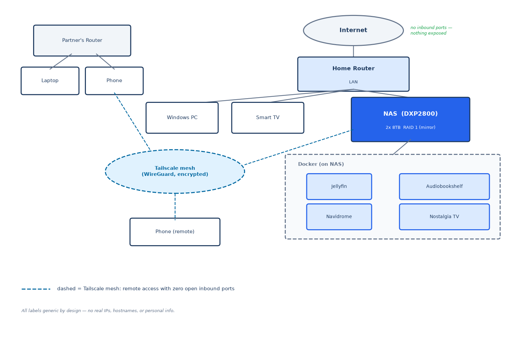

# Home Lab — NAS + Docker Services + Mesh VPN + DNS Filtering

A self-hosted home lab built and administered end-to-end by me: NAS storage,
Docker services, media server, network-wide DNS filtering, remote access over a
mesh VPN, and network segmentation with firewall rules.

This repo is my build log — it documents what I built, how it's configured,
and what I learned, as I work toward CompTIA Network+ and Cisco CCNA.

## The stack at a glance

| Layer | What runs there |
|---|---|
| Storage | UGREEN NASync NAS, RAID array on enterprise-grade HDDs, SMB shares with per-user permissions |
| Services | Docker containers: Jellyfin (media server), Audiobookshelf, Navidrome, Nostalgia TV |
| DNS | Pi-hole on the NAS — answers DNS for the whole LAN, filters ads and telemetry network-wide, Quad9 upstream |
| Networking | LAN + Tailscale subnet interfaces, firewall rules restricting management ports by source subnet |
| Remote access | Tailscale mesh VPN — services reachable remotely without opening inbound ports |

## Why I built it this way

**RAID 1 for resilience.** Two 8TB drives in a mirror — any single drive failure costs zero data and zero downtime. On a two-bay NAS, redundancy beats capacity: 8TB usable is enough, and the array is the foundation everything else (Docker, media, shares) sits on.

**Docker for isolation.** Every service runs in its own container with pinned
versions. I can rebuild a container from scratch in minutes without touching
the host or the storage layer.

**Tailscale for access.** Instead of exposing NAS services to the internet
(port-forwarding is how NAS boxes get owned), every connection rides an
encrypted WireGuard mesh. My NAS firewall rules only allow management ports
from the LAN and Tailscale subnets — everything else gets dropped.

**DNS as the enforcement point.** Pi-hole runs on the NAS and every device on the LAN resolves through it, because the router hands out the NAS as the DNS server. That makes DNS a single control plane for the whole household: one blocklist applies to phones, TVs, and the NAS itself, with nothing to install per device. I use it for privacy as much as for ads — the NAS vendor's own phone-home domains are sinkholed along with the usual tracking, so the box doesn't report on itself. It also taught me the honest trade-off: DNS is now a single point of failure, and the recovery procedure is written down before it's ever needed.

**SMB with least-privilege shares.** One write path, many read paths. Storage access stays with a single admin account — no per-user NAS accounts to maintain, no ACL surprises. Per-person access happens at the application layer instead: Jellyfin family profiles, Audiobookshelf for shared listening, Navidrome for music, each app enforcing its own user permissions against the same read-only library.

## What I learned building this

- Storage RAID rebuilds and the trade-offs between RAID levels
- Docker networking: container ports vs. host ports, and why a container
  listening on 0.0.0.0 is visible to every subnet unless firewalled
- Firewall rules per interface/source-subnet on the NAS itself
- WireGuard fundamentals: how a mesh VPN differs from a traditional
  site-to-site VPN, and why no open inbound ports beats port-forwarding
- Port conflicts, and how to find what's already holding a socket — the NAS's built-in dnsmasq had to be stopped and disabled before Pi-hole could bind port 53
- Why DNS services want host networking, and what container port mapping does to client IP visibility in a query log
- Bind-mount ownership: a blocklist database that can't write is a permissions problem, not an application bug
- Verifying a block properly: `nslookup` the blocked name (returns 0.0.0.0) and a known-good name in the same breath, so you prove the block *and* prove you didn't break resolution
- Failure-mode thinking: the router's DNS setting is the emergency switch if the Pi-hole container is ever down
- Real incident lessons: media library paths diverging from on-disk folders after reorganizing (three services had indexed the old layout), and retrofitting remote access — the mesh VPN should have been day one, not a retrofit.
  
## Where this is going

I'm studying for **CompTIA Network+**, then **Cisco CCNA**, and expanding the
lab toward: VLAN segmentation, a dedicated router/firewall, 10GbE backbone,
and hands-on Cisco switch/router configuration. This grant-funded next build
is detailed in [docs/next-steps.md](docs/next-steps.md).

## Repo contents

- `docs/` — topology diagram, lessons learned, planned upgrades
- `docker/` — compose files and notes for each container
- `storage/` — RAID setup and SMB share configuration notes
